<p align="center">
  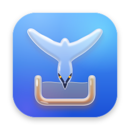
</p>

<h1 align="center">Osprey</h1>

<p align="center">
  <b>A fast, IDM-style download manager for macOS — with video downloads, browser capture, and a native Liquid Glass UI.</b>
</p>

<p align="center">
  
  
  
  
</p>

<p align="center">
  <picture>
    <source media="(prefers-color-scheme: dark)" srcset="docs/images/hero-dark.png">
    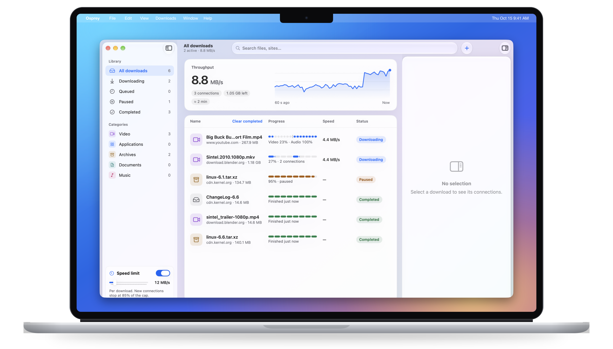
  </picture>
</p>

## Highlights

<table>
  <tr>
    <td width="33%" valign="top"><b>Up to 32 connections</b><br>Each file is split into segments that download in parallel, and new connections ramp up only while they help.</td>
    <td width="33%" valign="top"><b>Takes over from your browser</b><br>Chrome-family browsers and Safari hand matching downloads to Osprey, with a small progress window for each.</td>
    <td width="33%" valign="top"><b>Video and audio</b><br>YouTube and the other sites yt-dlp supports, with a picker for quality, audio language, subtitles and audio-only.</td>
  </tr>
  <tr>
    <td valign="top"><b>Playlists</b><br>A checklist of every entry, one quality choice for all, saved into a folder named after the playlist.</td>
    <td valign="top"><b>Never loses your place</b><br>Downloads survive quits, crashes and reboots, and resume where they stopped.</td>
    <td valign="top"><b>Private by design</b><br>Private-window downloads are never saved. Sign-in cookies live in the Keychain only until the download finishes.</td>
  </tr>
  <tr>
    <td valign="top"><b>Speed limiter</b><br>Cap each download from the sidebar without stopping it.</td>
    <td valign="top"><b>Organised for you</b><br>Categories by file type (Video, Applications, Archives, Documents, Music), each with its own folder.</td>
    <td valign="top"><b>Native and modern</b><br>SwiftUI with Liquid Glass on macOS 27, light and dark, and a Liquid Glass app icon.</td>
  </tr>
</table>

## Blazing-fast segmented downloads

Osprey checks a link before it starts: name, size, type and whether the server can resume. It then splits the file into segments and fetches them over several connections at once, up to 32 per download (8 by default). A download starts on one connection and doubles every second while every connection is still receiving data, so slow or picky servers aren't flooded.

- A live **throughput graph** and the totals for every active download.
- The **inspector** shows each connection's speed, the segment map, time left and average speed.
- A sidebar **speed limit** caps each download; new connections stop opening at 85 % of the cap.
- **Pause all** (⌥⌘P) and **Resume all** (⌥⌘R).

<p align="center">
  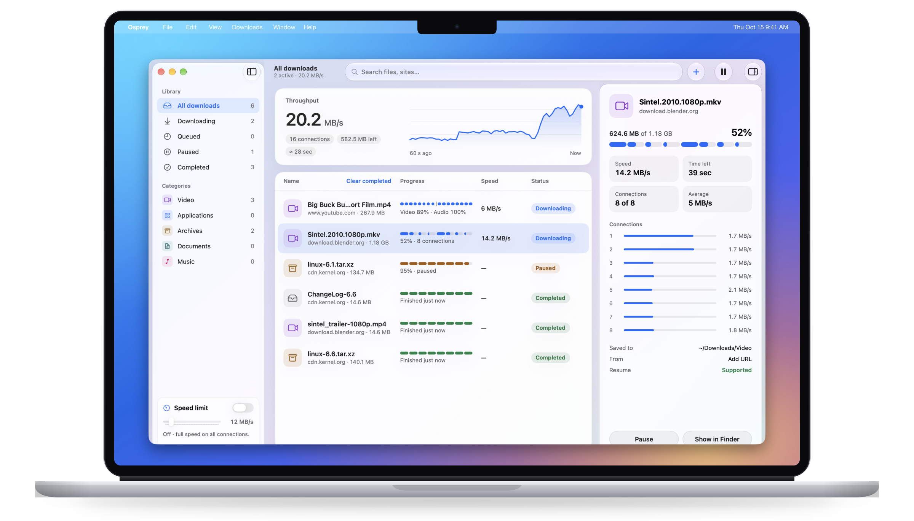
</p>

<p align="center">
  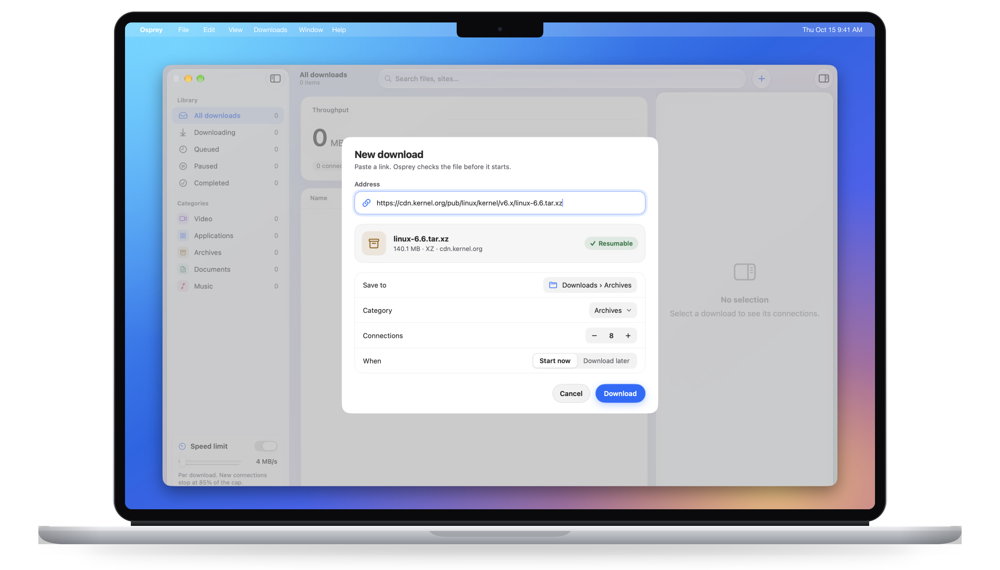
</p>

## Browser integration

Extensions for Chrome (and Chromium, Edge and Brave) and Safari hand downloads to Osprey. Which file types it takes over is up to you: the defaults cover archives, disk images, installers, video, audio and PDF.

- Each captured download opens a small **progress window** in the top-right corner, without bringing Osprey forward. Turn it off to get a notification instead.
- **Download with Osprey** in the right-click menu works on any link.
- Hold **⌥ Option** while clicking a link to let the browser download it.
- If Osprey can't take a download, the browser keeps it. If Osprey isn't running, the next matching download starts it in the background.

<p align="center">
  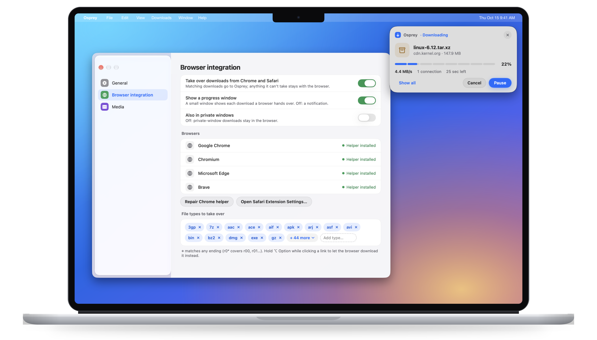
</p>

## Video & audio downloads

Paste a page link, right-click a page or video, or click the **Download video** button that appears over videos in the browser. Osprey reads the page with yt-dlp and opens a picker:

- **Quality**, each with an estimated size.
- **Compatible (MP4/H.264)**, on by default, for files that QuickTime and Photos play. Turn it off for the best quality (often VP9 or AV1), clearly marked *Won't play in QuickTime*.
- **Audio language** for videos with dubbed tracks. It defaults to English when there is an English track, and otherwise to the original.
- **Subtitles** in a searchable popover, including auto-generated captions, embedded in the file.
- **Audio only**: M4A (the original AAC) or MP3.

Video and audio download as separate parts, then ffmpeg joins them. Osprey manages its own copy of yt-dlp, verifies it against a checksum and keeps it up to date; ffmpeg comes from Homebrew or as a verified download.

<p align="center">
  <picture>
    <source media="(prefers-color-scheme: dark)" srcset="docs/images/video-picker-dark.png">
    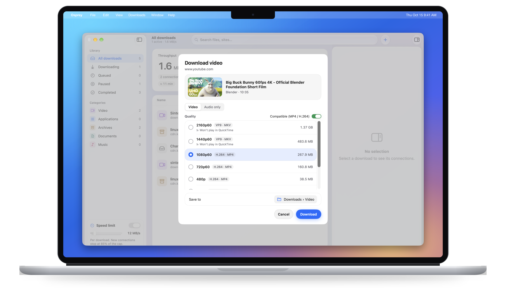
  </picture>
</p>

<p align="center">
  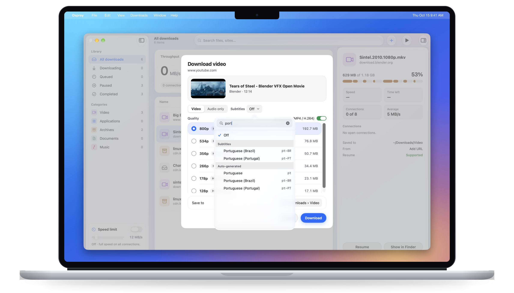
</p>

## Playlists

A playlist opens as a checklist with **Select all** and **Select none**. Titles fill in as they load, so long playlists open straight away. One quality and audio choice applies to every selected entry, and the files go into a folder named after the playlist. While entries are being added, a banner shows the progress and a **Stop** button; entries already added stay.

<p align="center">
  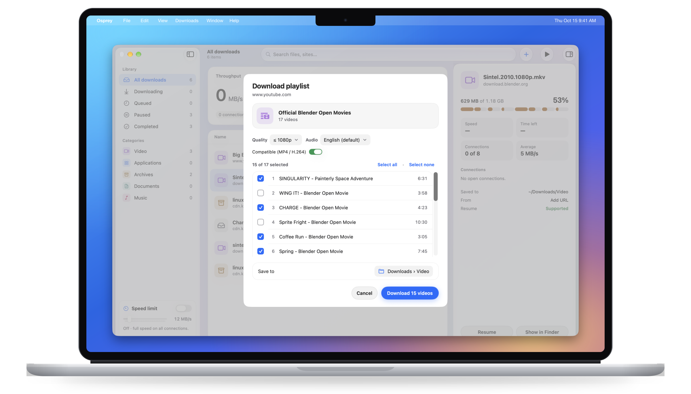
</p>

## Picks up where it left off

The download list is saved as you go, so quitting, a crash or a reboot doesn't lose anything. Unfinished downloads come back paused at the progress they reached and resume from there, on servers that support it. The inspector says which ones do.

- A completed file that was moved or deleted shows **File missing**, with **Retry** and **Remove from list**.
- **Clear completed** tidies the list in one click.

<p align="center">
  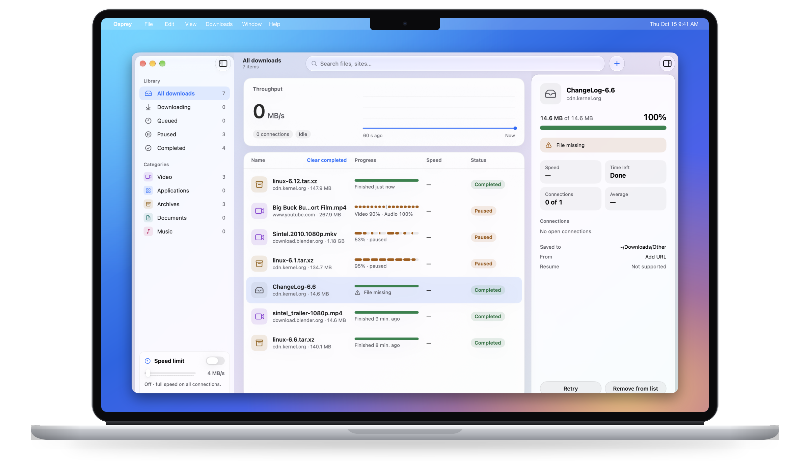
</p>

## Queues and a schedule

Downloads go into named queues. **Main** runs straight away: Start now and browser downloads go there. **Download later** puts a download in another queue (Later, unless you pick one), where it waits until that queue starts. **Move to queue** in a download's menu moves it between queues.

- A queue starts when you choose **Start now**, once at a date and time, or daily at a time on the weekdays you pick. It can stop at a set time. A start missed while the Mac slept or Osprey was closed still counts until its window ends.
- A queue can wait for Wi-Fi (not a phone hotspot or Low Data Mode), wait until the Mac is plugged in, and keep the Mac awake while it runs. Without a network, every queue but Main waits.
- When a queue finishes by itself, it can notify you, quit Osprey, or put the Mac to sleep or shut it down. Sleep and Shut down count down 60 seconds first, with **Cancel**, and don't happen if downloads are running again by then.
- Each queue's status shows in the sidebar: "Running · 2 of 3", "Starts 2:00 AM", "Nothing waiting", "Waiting for Wi-Fi", "Offline — waiting".

## Privacy-first

- **Private windows stay private.** Downloads from private windows stay with the browser unless you turn on *Also in private windows*. Private downloads are never written to the saved list or the Keychain, and their notifications never show the file name.
- **Cookies only in the Keychain.** When a download needs you to be signed in, its `Cookie` and `Authorization` headers are kept in the login Keychain, and only until the download finishes or is removed.
- **Video cookies are short-lived.** The browser sends cookies for the page's site only. Osprey writes them to a temporary file readable only by you, deletes it right after the lookup or download, and never logs them. Add URL sends none.
- **A locked-down bridge.** The browser extensions talk to the app over a socket in the app's App Group container, and the app accepts only binaries signed by the same team.

## A native Mac app

Settings are short and plain: appearance (System, Light or Dark), default connections and **Open at login** (so schedules survive a restart), browser integration, and media folders and tools.

<p align="center">
  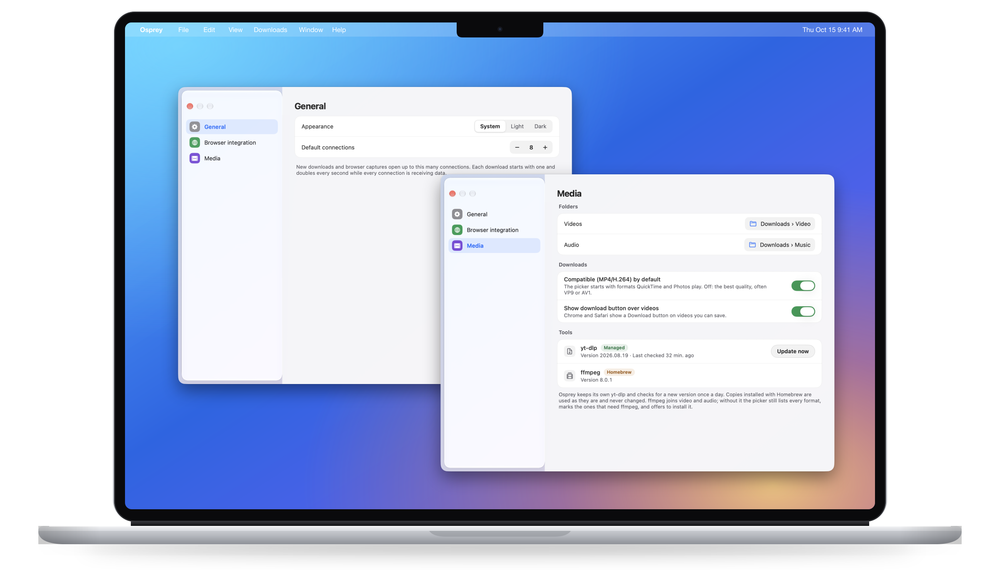
</p>

## How it compares

|                                  | Osprey                                         | Typical browser download        |
| -------------------------------- | ---------------------------------------------- | ------------------------------- |
| Connections per file             | Up to 32, added as long as they help           | Usually one                     |
| Resume after a quit or reboot    | Yes, from where it stopped (if the server allows) | Varies; often starts over      |
| Speed limit                      | Per download, from the sidebar                 | No                              |
| Video and audio from web pages   | Yes, with quality, language and subtitles      | No                              |
| Playlists                        | Yes, as a checklist                            | No                              |
| Scheduling                       | Queues that start and stop on a timetable      | No                              |
| Sorting                          | Categories with their own folders              | One Downloads folder            |
| Insight while downloading        | Throughput graph, per-connection speeds        | A progress bar                  |

Speed gains depend on the server and your connection; a server that limits each connection benefits most.

## Getting started

### Requirements

- macOS 15 or later to run. The Liquid Glass look needs macOS 26 or later.
- Xcode 27 (Swift 6.4) and [XcodeGen](https://github.com/yonaskolb/XcodeGen) to build.
- Optional: Homebrew `ffmpeg`. Without it, Osprey offers to download a verified build when a format needs it.

### Build and install

Build into a folder outside iCloud-synced folders such as Desktop or Documents; code signing fails for build output stored there. Install a **Release** build: Debug builds keep development switches that Release compiles out.

```sh
xcodegen generate
xcodebuild -project Osprey.xcodeproj -scheme Osprey -configuration Release \
  -derivedDataPath /tmp/osprey-dd -allowProvisioningUpdates build
ditto /tmp/osprey-dd/Build/Products/Release/Osprey.app /Applications/Osprey.app
open /Applications/Osprey.app
```

On every launch, Osprey writes the browser helper manifest for Chrome (and Chromium, Edge and Brave, when they are installed). It points at the copy of the app that ran last, so launch the `/Applications` copy last.

> **Signing.** `project.yml` is set up for the author's development team (`8CG9QYMSR5`). To build under your own team, replace that ID in `project.yml`, the three `.entitlements` files and `Osprey/Sources/OspreyBridge/BridgeLocation.swift`. The browser bridge only accepts binaries signed by that team.

### Chrome extension

1. Open `chrome://extensions` and turn on **Developer mode**.
2. Click **Load unpacked** and choose the `Extensions/chrome` folder.
3. The extension ID stays `hdaelhdfolkmnghifnpopgadkndofanj`, fixed by the `key` in its manifest.
4. Click the toolbar icon. **Connected** means matching downloads go to Osprey. If it says it **can't reach Osprey**, open Osprey or use **Settings → Browser integration → Repair Chrome helper**.

### Safari extension (experimental)

Safari support hasn't been through its full set of manual checks yet.

1. Locally built extensions are signed for development, so allow them: turn on **Safari → Settings → Advanced → Show features for web developers**, then choose **Develop → Allow Unsigned Extensions**. Safari turns this off again when it quits.
2. Launch Osprey and accept the **Turn on Osprey in Safari** prompt, or open **Safari → Settings → Extensions**.
3. Tick **Osprey**, then choose **Always Allow on Every Website**.

Safari has no downloads API, so only link clicks are taken over. Use **Download with Osprey** in the right-click menu for anything else.

More detail, including troubleshooting and the manual test checklist, is in [docs/browser-integration-setup.md](docs/browser-integration-setup.md).

## Architecture

Osprey is a Swift package of focused modules, plus an Xcode project (generated by XcodeGen) that bundles the app, the native-messaging host and the Safari extension.

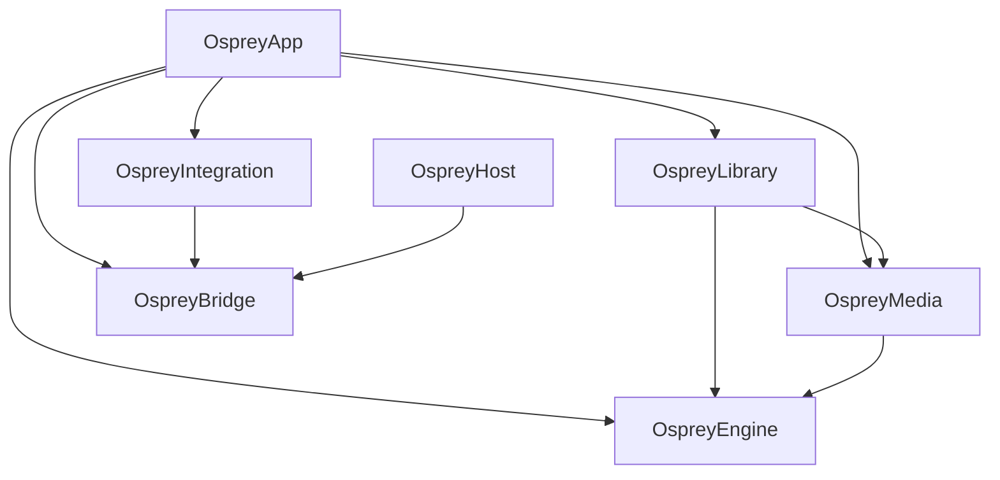

| Module | Role |
| --- | --- |
| `OspreyEngine` | The download engine: HTTP probing, segment maps, connection ramp-up, speed limits and resumable storage. |
| `OspreyBridge` | The framed JSON protocol and socket between the app, the native-messaging host and the Safari extension, with code-signature checks on peers. |
| `OspreyIntegration` | Capture rules and routing, the browser helper manifests, and the one-time import from the app's earlier name. |
| `OspreyMedia` | yt-dlp and ffmpeg management, format catalogs, the picker's logic, subtitles, audio languages and playlists. |
| `OspreyLibrary` | The saved download list and queues, restoring them at launch, the scheduler's rules, the Keychain credential vault and the quit sequence. |
| `OspreyApp` | The SwiftUI app: main window, inspector, sheets, settings and capture progress windows. |
| `OspreyHost` | The native-messaging host Chrome launches; it relays requests to the running app. |

The browser extensions live in `Extensions/` (`chrome`, `safari`, and `shared` code synced into both).

## Testing

```sh
# Swift tests (Swift Testing), about 585
cd Osprey && swift test

# Extension tests (Node's built-in test runner), about 179
cd Extensions && npm test
```

If the repository sits in an iCloud-synced folder, keep SwiftPM's build output outside it: `swift test --scratch-path /tmp/osprey-swiftpm`.

## Roadmap

- **Mac integration:** Shortcuts actions, a Share extension, a Finder Quick Action and notifications.

## Acknowledgements

- [yt-dlp](https://github.com/yt-dlp/yt-dlp), which reads the video and audio formats of web pages.
- [FFmpeg](https://ffmpeg.org), which joins video and audio and converts audio to MP3.

The screenshots use public, openly licensed content: Linux kernel tarballs from kernel.org and Blender Foundation open movies (Big Buck Bunny, Sintel, Tears of Steel and others, CC BY).

## Disclaimer

Inspired by Internet Download Manager (IDM). Not affiliated with or endorsed by Tonec Inc.

Downloads only what you're allowed to; DRM-protected media is not supported.
